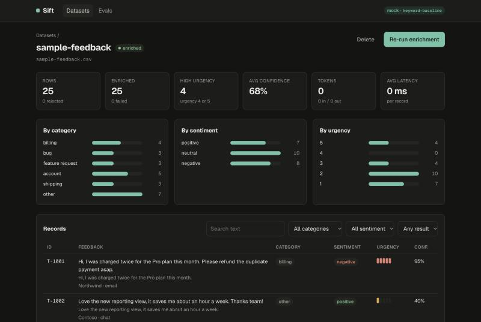
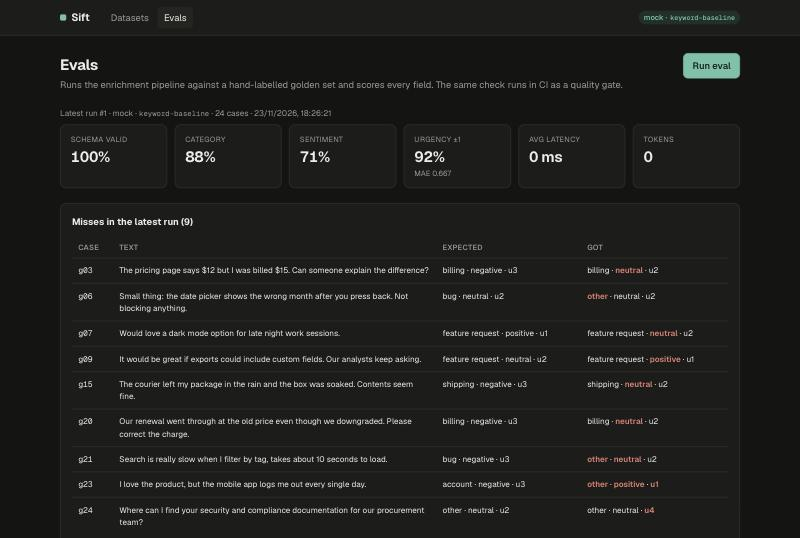
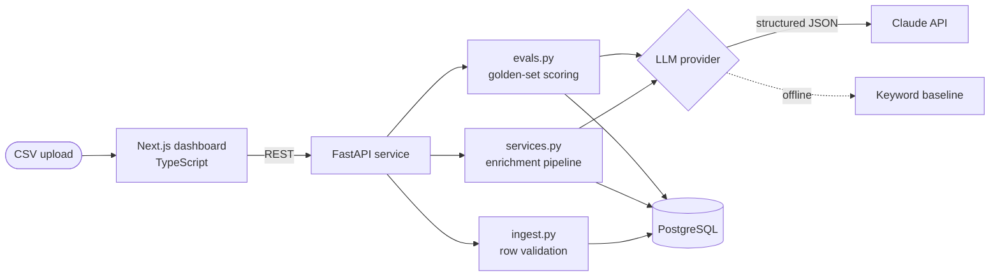

# Sift

[](https://github.com/anushagarg-10/sift/actions/workflows/ci.yml)


**An AI data pipeline that turns raw customer feedback into prioritised, labelled insight.**

Upload a CSV of support tickets or reviews. Sift validates every row, stores the clean data in PostgreSQL, has an LLM label each record with sentiment, category, urgency and a one-line summary, and shows the results in a filterable dashboard. A built-in eval harness scores the model against a hand-labelled test set, so changes to prompts or models are measured rather than guessed.



## Quick start

You only need Docker. No API key is required: by default Sift runs on an offline classifier.

```bash
git clone https://github.com/anushagarg-10/sift.git
cd sift
docker compose up --build
```

Open **http://localhost:3000**, click **Use sample data**, then **Run enrichment**.
Interactive API docs are at **http://localhost:8000/docs**.

## What it does

| Step | What happens |
| --- | --- |
| **1. Ingest** | The CSV is parsed and every row is validated. Bad rows (missing fields, duplicate IDs, oversized text, extra columns) are rejected with a line number and a reason. Clean rows are saved, so one broken line never sinks an upload. |
| **2. Enrich** | Each record is sent to the LLM, which must answer in a fixed JSON schema. The answer is validated again with Pydantic, retried if it fails, and stored with its token usage and latency. |
| **3. Explore** | The dashboard shows totals, breakdowns by category, sentiment and urgency, and a searchable table of records. Clicking a bar filters the table. |
| **4. Evaluate** | The same pipeline runs against 24 hand-labelled cases and reports accuracy for every field. Results are saved, so each run can be compared with the last. |



## Architecture



Enrichment runs as a background task over a bounded thread pool, and the dashboard polls the dataset's status until the job finishes. Everything runs as three containers (Postgres, API, dashboard) with health checks and startup ordering.

## Engineering decisions

**The LLM's output is validated twice.** Claude's structured outputs force the response into a JSON schema, but a valid shape is not the same as valid data. A second, stricter Pydantic model enforces business rules: urgency must be 1 to 5, confidence 0 to 1, the category must be one of six labels, and the summary must be a sensible length. Keeping the model-facing schema simple and the rules in our own code makes those rules easy to test.

**Failures are recorded, not hidden.** Output that fails validation is retried once. If it still fails, or the model declines, the record is saved as `failed` with a readable reason, and the dashboard can filter to just those rows. Network and rate-limit errors are left to the SDK's own retry logic rather than retried twice.

**Providers are swappable.** The pipeline talks to a small `LLMProvider` interface. `LLM_PROVIDER=anthropic` uses Claude; `LLM_PROVIDER=mock` uses a deterministic keyword classifier. The mock means the app, the tests and CI run with no API key and no cost, and it gives a baseline that any real model must beat.

**Evals gate the build.** `python -m app.evals` exits with an error when accuracy falls below set thresholds, and CI runs it on every push. A prompt change that quietly makes the classifier worse fails the build instead of reaching users.

**Feedback text is treated as data.** Customer text is wrapped in tags and the system prompt tells the model to ignore any instructions inside it, which reduces prompt-injection risk from user-submitted content.

**Cost and speed are visible.** Every enrichment stores the model, number of attempts, input and output tokens, and latency, so each dataset shows what it cost to process.

## Tests and evals

```bash
cd backend
pip install -e ".[dev]"
pytest                    # 35 tests
python -m app.evals --min-category 0.8 --min-sentiment 0.65
```

The suite covers CSV validation edge cases, the validate-and-retry logic, the Claude provider (offline, against a fake client), every API endpoint, and the eval metrics. Tests use SQLite locally for speed and a real Postgres service container in CI.

CI runs three jobs on every push: backend (ruff, pytest on Postgres, eval gate), frontend (ESLint, type check, production build), and a Docker build of both images.

**Scores on the golden set**

| Provider | Category | Sentiment | Urgency within 1 | Schema valid |
| --- | --- | --- | --- | --- |
| Keyword baseline (`mock`) | 88% | 71% | 92% | 100% |
| Claude | not yet measured | | | |

## Using Claude

```bash
cp .env.example .env      # then set ANTHROPIC_API_KEY
docker compose up --build
```

The top bar of the dashboard shows which provider and model are active. Run an eval from the **Evals** page to compare Claude with the baseline. The model defaults to `claude-opus-5-5` and can be changed with `LLM_MODEL`.

## Running without Docker

```bash
# API (uses Postgres by default; set DATABASE_URL=sqlite:///./sift.db to skip it)
cd backend
python -m venv .venv && source .venv/bin/activate
pip install -e ".[dev]"
uvicorn app.main:app --reload

# Dashboard
cd frontend
npm install
npm run dev
```

## Reference

<details>
<summary><strong>API endpoints</strong></summary>

| Method | Path | Purpose |
| --- | --- | --- |
| `POST` | `/datasets` | Upload a CSV (multipart). Returns accepted and rejected rows. |
| `GET` | `/datasets` | List datasets |
| `GET` | `/datasets/{id}` | Dataset detail with aggregate stats |
| `GET` | `/datasets/{id}/records` | Records, filterable by `sentiment`, `category`, `min_urgency`, `status`, `q`, with paging |
| `POST` | `/datasets/{id}/enrich` | Start enrichment in the background |
| `DELETE` | `/datasets/{id}` | Delete a dataset and its records |
| `POST` | `/evals/run` | Score the active provider on the golden set |
| `GET` | `/evals` | Eval run history |
| `GET` | `/config` | Active provider and model |

</details>

<details>
<summary><strong>CSV format</strong></summary>

| Column | Required | Notes |
| --- | --- | --- |
| `id` | yes | Unique within the file |
| `text` | yes | The feedback, up to 4,000 characters |
| `customer` | no | |
| `channel` | no | e.g. email, chat, phone |

A sample file is at [`backend/sample_data/feedback.csv`](backend/sample_data/feedback.csv).

</details>

<details>
<summary><strong>Configuration</strong></summary>

| Variable | Default | Purpose |
| --- | --- | --- |
| `LLM_PROVIDER` | `mock` | `mock` or `anthropic` |
| `LLM_MODEL` | `claude-opus-5-5` | Claude model to use |
| `LLM_EFFORT` | `low` | Claude effort level |
| `LLM_MAX_WORKERS` | `4` | Records processed in parallel |
| `LLM_MAX_RETRIES` | `1` | Retries for output that fails validation |
| `ANTHROPIC_API_KEY` | | Required when `LLM_PROVIDER=anthropic` |
| `DATABASE_URL` | local Postgres | SQLAlchemy connection string |

</details>

<details>
<summary><strong>Project layout</strong></summary>

```
backend/
  app/
    main.py            FastAPI routes
    ingest.py          CSV parsing and row validation
    services.py        enrichment pipeline, retries, stats
    evals.py           golden-set scoring and CLI gate
    llm/schema.py      model-facing and stored Pydantic schemas
    llm/providers.py   Claude and keyword-baseline providers
    models.py          SQLAlchemy tables
  evals/golden.csv     hand-labelled eval cases
  tests/               Pytest suite
frontend/
  src/app/             dashboard pages (datasets, dataset detail, evals)
  src/lib/api.ts       typed API client
docker-compose.yml
.github/workflows/ci.yml
```

</details>

## Roadmap

- Measure Claude on the golden set and publish the comparison
- Database migrations with Alembic
- A hosted demo
